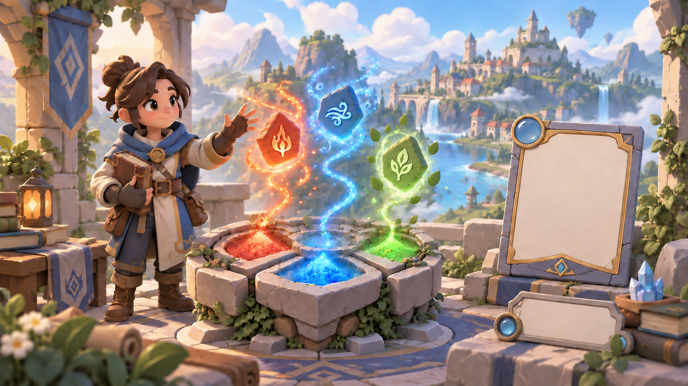

# Rune Mastery Art Guidelines

## Purpose and Authority

This directory is the source of truth for Rune Mastery's visual intent, shared art rules,
faction-specific visual guidance, and review references.

It defines how the game should look. It does not contain final production assets and does not
redefine gameplay, lore, or product behavior.

Related authorities:

- [Game Concept](../design/game_concept.md) defines the high-level game and player fantasy.
- [Game Design Principles](../design/game_design_principles.md) defines product decision rules.
- [Game Design Document](../design/game_design_document.md) links to the owning gameplay and world
  specifications.
- [`output/`](../../output/) is the only working directory for generated and produced results.

When art depends on a gameplay, faction, world, or feature rule, link to its owning design document
instead of copying that rule here.

## Directory Map

```text
guidelines/art/
  README.md
  core/
    direction/
    concepts/
      images/
        concept_reference/
    environment/
      images/
        concept_reference/
  factions/
    ancientflame/
    stormspears/
    circle of prophecy/
    dragon sisterhood/
    flamebound/
    storm circle/
```

| Directory | Responsibility |
|---|---|
| `core/` | Shared visual foundations and references that apply across Rune Mastery |
| `core/direction/` | Shared rendering, shape, color, material, lighting, detail, camera, and motion language |
| `core/concepts/` | Cross-game concept briefs and overview references |
| `core/environment/` | Shared world-foundation, architecture, nature, atmosphere, and environmental-magic guidance |
| `factions/` | Entry point for faction-specific visual guidance |
| `factions/<faction>/` | Visual rules and references unique to one faction |

Additional category directories should be created only when they own distinct guidance or review
material. Do not create empty parallel structures merely for symmetry.

## Inheritance Rule

`core/` defines the common visual system. Faction guidance extends that system; it does not replace
or duplicate it.

- Put a rule in `core/` when it applies to more than one faction or asset family.
- Put a rule in a faction directory only when it is genuinely specific to that faction.
- Link back to the shared rule instead of restating it.
- If faction guidance conflicts with an approved core rule, the core rule remains authoritative
  until the conflict is explicitly reviewed and resolved.
- Rune affinity and faction identity remain distinct. Faction art may draw from an affinity but
  must not reduce a faction to a recolored rune type.

## Current Concept Reference

The [Core Concept Brief](core/concepts/concept_brief.md) records the reference's purpose, limits,
technical facts, review criteria, provenance, and review status.



| Image | Purpose | Status |
|---|---|---|
| `core/concepts/images/concept_reference/concept_overview_v001.png` | Review the overall fantasy tone, elemental rune identities, card-game context, and broad material direction together | Concept reference |

This image supports discussion and comparison. Its presence does not approve every depicted
character, environment, component, composition, or production detail.

## Image Stages

Store images beside the category that uses them under an explicit stage directory.

| Stage | Purpose |
|---|---|
| `concept_reference` | Explore or communicate visual intent for review |
| `modeling_reference` | Provide orthographic, part-focused, proportion, or construction guidance |
| `production_reference` | Record an explicitly accepted reference suitable for production handoff |
| `superseded_reference` | Preserve a replaced or rejected direction for traceability |
| `legacy` | Preserve historical material that no longer represents the current direction |

An image becomes a production reference only through an explicit review decision. Moving or naming
a file does not approve it by itself.

## Working Rules

1. Start from the game concept and the owning design specification.
2. Inspect existing core and faction guidance before proposing a new direction.
3. Define observable visual properties such as shape, silhouette, value, palette roles, materials,
   lighting, detail density, camera, and motion.
4. Approve one representative visual target before producing a large asset family.
5. Keep generated references local to the category and stage they support.
6. Record purpose, review status, and revision notes beside each meaningful reference.
7. Create working results only under `output/`.
8. Validate assets at native game scale and in representative gameplay context.
9. Treat engine import, runtime behavior, and performance validation as required production checks.
10. Record provenance and usage rights before an asset is considered shippable.

## Generated Images

Generated images are review material by default, not final game assets. They may establish visual
intent or guide later modeling, illustration, UI, animation, or VFX work.

- Do not expose raw generation prompts in reader-facing review documents.
- Do not treat generated grids, transparency, dimensions, seams, pivots, or layer separation as
  reliable without inspection.
- Do not call an image production-ready until the relevant technical, native-scale, and in-engine
  checks pass.
- When a reference no longer represents the intended result, move it to `superseded_reference/` or
  `legacy/` rather than silently replacing its meaning.

## Asset Records and Provenance

Every produced asset family should have a stable identity and an accompanying record containing:

- purpose and owning feature or system;
- source or creator and acquisition or generation date;
- license, attribution, and usage restrictions;
- dimensions, format, color space, transparency, and relevant technical constraints;
- variants, states, layers, pivots, and animation requirements where applicable;
- review status and reviewer; and
- native-scale and in-engine validation evidence.

Approval of visual intent and production readiness are separate states. A reference can be approved
as direction while its resulting runtime asset still requires normalization, import, and validation.

## Maintenance Rule

Keep each decision in one owning document. Update this README only when art-directory ownership,
structure, stages, or shared workflow changes. Update detailed visual rules in their owning `core/`
or faction document and link to them from related briefs or reviews.
