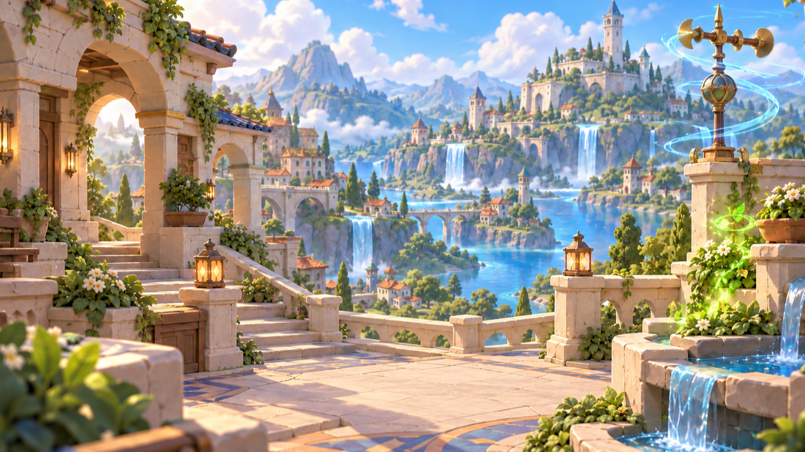

# Environment Concept

## Purpose

This document defines the shared environmental intent for Rune Mastery. It describes how places,
architecture, natural forms, atmosphere, and environmental magic create a coherent world while
remaining visually subordinate to cards, controls, characters, and gameplay state.

The environment provides physical grounding, scale, depth, and fantasy context. It does not define
gameplay rules, faction identity, screen behavior, runtime implementation, or final production
assets.

## Environment Goal

Rune Mastery's world feels inviting, tangible, old, crafted, and quietly magical. Ancient
stonework, inhabited architecture, natural growth, water, distant mountains, and elemental energy
belong to the same place.

The environment should:

- establish a calm physical stage for strategic information;
- provide depth and wonder without becoming visually overwhelming;
- feel maintained and inhabited rather than ruined, sterile, or ornamental for its own sake;
- use magic as a focused part of the world rather than a constant full-screen effect; and
- preserve clear visual space for cards, controls, labels, characters, and changing content.

## World-Foundation Role

The environment is the lowest and quietest visual layer. It grounds every other visual family but
does not communicate interaction, ownership, rarity, reward, availability, or faction by itself.

| Responsibility | Direction |
|---|---|
| Physical grounding | Use dimensional materials, stable construction, contact shadows, and clear scale cues |
| Visual support | Keep broad areas calm enough for foreground content to remain legible |
| Depth | Separate foreground framing, active or supporting middle ground, and simplified distance |
| Cohesion | Reuse the shared material and lighting logic across locations |
| Identity restraint | Keep elemental and faction cues local, deliberate, and secondary to the place itself |

Background detail must simplify before it competes with gameplay information. Decorative richness
may support a focal area, but it should not distribute equal contrast and detail across the scene.

## Spatial Language

### Layering

Environments use a readable three-part depth structure:

1. **Foreground framing** uses partial architecture, foliage, props, or terrain to establish depth
   without blocking primary content.
2. **Middle ground** contains the clearest environmental forms, main landmark, character support,
   or gameplay-adjacent space.
3. **Background distance** uses simpler silhouettes, reduced contrast, softer detail, and controlled
   atmospheric depth.

Depth comes from overlap, scale, value separation, focus, and atmospheric softness. Global fog,
uniform blur, or dense particle fields should not be used as substitutes for composition.

### Composition

- Establish one clear environmental landmark or structural rhythm rather than many competing focal
  points.
- Reserve calm negative space around important foreground content and likely UI regions.
- Keep high-contrast edges, bright magic, and dense texture away from text and control areas.
- Use asymmetry to create a natural, inhabited scene while retaining a stable visual balance.
- Avoid tangencies that merge characters, cards, props, or landmarks with the background.
- Author full-screen backgrounds with enough peripheral tolerance to support required aspect-ratio
  crops without stretching.
- Keep important landmarks and identity cues out of expendable crop zones.

### Scale and Construction

- Use broad architectural masses before small decoration.
- Show believable supports, joins, stairs, bridges, walls, ledges, and foundations.
- Reinforce scale with doors, windows, railings, trees, books, tools, furniture, or distant figures
  only when they do not create clutter.
- Prefer rounded wear and softened edges over shattered silhouettes, dense rubble, or aggressive
  spikes.
- Maintain stable construction even when magic is present; magical effects should not make the
  environment appear weightless or structurally arbitrary.

## Architectural Language

The shared architecture combines old masonry, practical craft, restrained ornament, and open views
into a readable fantasy setting.

| Area | Direction | Avoid |
|---|---|---|
| Massing | Terraces, towers, bridges, arches, walls, platforms, and clustered settlements built from broad forms | Fragmented silhouettes and excessive vertical needles |
| Stonework | Warm cream limestone with modeled blocks, soft bevels, limited wear, and clear structural joints | Crystalline stone, chalky surfaces, dense cracks, or noisy engraving |
| Metal | Antique gold or bronze at caps, rails, joins, fixtures, and selected structural accents | Mirror chrome or large uninterrupted gold surfaces |
| Wood and leather | Warm supporting materials with sparse highlights and visible construction roles | Random dark trim or uniform high-frequency grain |
| Ornament | A few large, intentional motifs integrated into construction | Repeated micro-decoration that competes with content |
| Condition | Aged, maintained, inhabited, and softened by time and nature | Grim decay, heavy dirt, battlefield ruin, or sterile perfection as the default |

Faction-specific architecture may reinterpret silhouette, motif, and material emphasis, but each
location should still feel compatible with the shared rendering, construction, and readability
principles.

## Natural Language

- Group foliage into simple readable masses before introducing individual leaves.
- Use natural olive and fresh greens as support colors rather than a uniform saturation wash.
- Let vines, shrubs, flowers, and moss soften architecture without obscuring paths, joins, or focal
  silhouettes.
- Use water as a calm depth and light element; preserve readable shapes and avoid excessive sparkle.
- Simplify mountain, cloud, island, and distant-building silhouettes as they recede.
- Keep sky and atmospheric color clean enough to provide separation behind architecture, magic,
  characters, and UI.
- Use environmental motion such as leaves, clouds, water, banners, or motes as optional ambience,
  never as the only cue for place or state.

## Material and Palette Roles

| Role | Preferred treatment |
|---|---|
| World base | Warm cream limestone, softly worn masonry, warm wood, brown leather, and broad-fold cloth |
| Cool structural balance | Slate and royal blue used in large calm planes where needed |
| Structural accent | Restrained antique gold or bronze with controlled highlights |
| Nature | Natural greens, clean blue sky fill, water blue, and subdued earth tones |
| Elemental magic | Local Fire, Air, or Forest color attached to a clear source and stable form |
| Distance | Reduced contrast, softer detail, and cooler or lighter atmospheric separation |

Color supports material, depth, and focus. Neutral blue does not automatically mean Air, green does
not automatically mean Forest, and warm light does not automatically mean Fire. Elemental identity
requires a deliberate local source and the appropriate stable symbol or form.

## Lighting and Atmosphere

1. Use a soft warm key from the upper left to establish form and material.
2. Use clean cool ambient fill to preserve readable shadow color and atmospheric depth.
3. Use contact shadows and restrained ambient occlusion to ground structures and separate layers.
4. Keep elemental illumination local, color-matched, and subordinate to the main lighting.
5. Preserve clear midtones, moderate saturation, gentle contrast, and controlled highlight rolloff.
6. Keep limestone, clouds, water, foliage, and skin-neutral reflections free from a pervasive orange
   or pink cast.

Atmosphere should clarify distance and mood without flattening the value structure. Avoid global
fog, excessive bloom, hard light halos, uniform haze, and particle density that conceals silhouettes
or UI-safe regions.

## Environmental Magic

- Give every magical effect a visible source, affected area, and controlled falloff.
- Keep glyphs, stones, conduits, pools, plants, or crafted devices readable beneath their effects.
- Let local light affect nearby surfaces without recoloring the whole environment.
- Separate permanent environmental construction from temporary glow, particles, trails, and event
  treatment.
- Avoid free-floating effect clouds that do not explain their relationship to the place.
- Do not use environmental magic as the sole indicator of gameplay state or faction identity.

## Primary Environment Reference

| Image | Purpose | Status |
|---|---|---|
| `environment_overview_v001.png` | Evaluate the shared architectural massing, world materials, landscape depth, natural balance, lighting, crop tolerance, and integration of localized environmental magic | Concept reference |

The reference supports the shared environment concept. It does not approve the depicted settlement,
castle, tower, terrace, landscape layout, or landmark as a canonical game location.

## Reference Reading

| Observed property | Keep | Do not infer |
|---|---|---|
| Limestone terrace and arches | Broad construction, warm stone, soft wear, rounded modeled edges | A universal building plan or mandatory architectural motif |
| Distant settlement and castle | Layered scale, readable landmark hierarchy, inhabited-world impression | A canonical city, capital, or faction home |
| Water, mountains, sky, and clouds | Open depth, calm color balance, and atmospheric separation | A fixed world map, geography, climate, or biome |
| Foliage and flowers | Natural softening of built forms and controlled foreground framing | Universal vegetation or faction symbolism |
| Wind vane, garden glow, and lantern light | Local magic and light integrated with physical materials | Elemental identity, permanent placement, or environmental gameplay rules |
| Lanterns, planters, railings, doors, and stairs | Human scale, craft, access, and habitation | Mandatory props for every scene |
