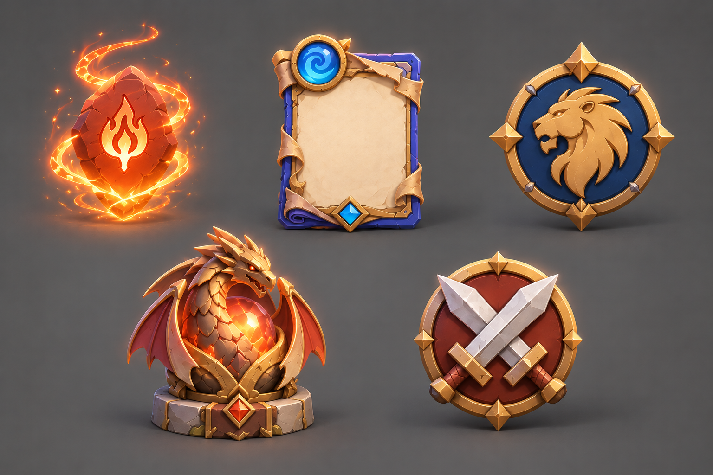

# Gameplay Object Concepts

## Purpose

This document translates Rune Mastery's approved gameplay meanings into a shared visual direction
for reusable objects. It guides concept review; it does not redefine game rules or approve final
production assets.

Object meaning and scope come from
[Visual Objects](/Users/mnader/Documents/MyGitFolder/BattleRunes/GameDesign/90_CrossCutting/Visual_Objects.md)
and the owning Game Design systems. All concepts inherit the
[Core Art Direction](../direction/art_direction.md).

## Concept Direction

- Use clean stylized 3D forms, rounded bevels, calm color planes, and low surface noise.
- Prioritize a distinct silhouette and one primary symbol before ornament or small detail.
- Use neutral stone, slate, and restrained metal for structure; localize elemental, faction, state,
  and reward accents.
- Light forms with a warm upper-left key, cool ambient fill, grounded contact shadows, and
  restrained local glow.
- Keep identity, gameplay state, and reward tier understandable without relying on color, glow, or
  motion alone.
- Keep names, quantities, timers, and other changing information out of reusable artwork.
- Design related objects as coherent families with consistent scale, view, lighting, materials, and
  detail density.

## Object Families

| Family | Required visual relationship |
|---|---|
| Runes | Fire, Air, and Forest use stable glyph identities. Glyph and `Locked`, `Available`, or `Empty` state remain separate, composable cues. |
| Cards | Creature, Spell, and Artifact remain distinguishable by structure. Rune cost, faction, rarity, edition, values, and interaction state remain separate information channels. |
| Factions | Each faction uses one stable, compact symbol distinct from rune glyphs. Dual-affinity factions receive independent marks rather than combined parent symbols. |
| Progression | Rune Dust, Dragon Relics, Scrolls, Scroll Fragments, Crafted Cards, and Reserved Cards feel related but never interchangeable. Higher tiers add structure without making lower tiers look defective. |
| Deck, reward, and match objects | Draft/Ready, Claimable/Claimed/Locked, and AI/PvP/Event identities use recognizable shape or symbol cues in addition to color. |

## Primary Reference

| Reference | Purpose | Status |
|---|---|---|
| [`core_objects_v001.png`](images/concept_reference/core_objects_v001.png) | Review the five gameplay-object families together for cohesion, silhouette, materials, state separation, and small-object readability | Concept reference |

## Review Criteria

A concept is suitable for focused asset development when it:

- communicates its identity and state at the intended display size and in grayscale;
- belongs visibly to its object family and the shared Rune Mastery art direction;
- remains legible over representative gameplay backgrounds; and
- separates canonical identity, state, optional effects, and dynamic content.
